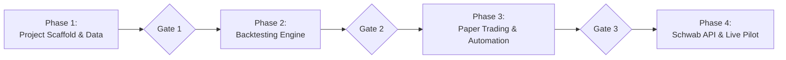

# Master Plan: Buy-at-Close, Sell-at-Open AI Trading Agent

This document defines the consolidated requirements, system architecture, and step-by-step phased execution roadmap. Each phase has clear deliverables, testing criteria, and an approval gate before proceeding.

---

## 1. Consolidated Requirements Matrix

| Requirement Area | Specification | Rationale / Safety Rule |
| :--- | :--- | :--- |
| **Market / Exchange** | US Equities (NYSE / NASDAQ) | Standard US trading hours (9:30 AM – 4:00 PM ET). |
| **Brokerage** | **Charles Schwab** | Existing user brokerage; utilizes Schwab Trader REST/OAuth API. |
| **Asset Universe** | **Tech Large Caps + Benchmark** (`QQQ`, `AAPL`, `MSFT`, `NVDA`, `AMZN`, `GOOGL`, `META`, `TSLA`) | Liquid, low bid-ask spread, high overnight momentum drift. |
| **Trading Strategy** | **Buy-at-Close, Sell-at-Open (Overnight Drift)** | Buys before 4:00 PM ET, sells at 9:30 AM ET open. No PDT restrictions. |
| **Strategy Filters** | 1. **Market Regime Filter** (QQQ > 20 EMA)<br/>2. **Earnings Blackout Filter** (mandatory)<br/>3. **Momentum/Pullback Scoring** | Avoids buying into broad market downturns and eliminates catastrophic post-market earnings gap downs. |
| **Backtesting Engine** | Historical simulation on Daily OHLCV data (2018–Present) | Evaluates Sharpe ratio, Max Drawdown, Win Rate, and overnight vs. buy-and-hold returns. |
| **Safety & Risk Controls** | Hard-coded deterministic engine: max position limits, portfolio allocation caps, manual kill switch | Decouples AI reasoning from direct order submission to prevent catastrophic hallucination. |
| **Execution Progression** | **Backtest -> Local Paper Simulator -> Schwab Live (1-share) -> Full Sizing** | Ensures complete control and operational verification at every milestone. |

---

## 2. End-to-End System Architecture

```mermaid
flowchart TD
    subgraph Data & Signal Pipeline
        MKT[Market Data: yfinance / Schwab Quotes]
        EARN[Earnings Calendar Feed]
        REGIME[Regime Filter: QQQ Trend]
        AI[Agent Signal Scorer / Ranking]
    end

    subgraph Backtesting Engine (Phase 2)
        HIST[Historical Data Cache: 2018-Present]
        SIM_BT[Overnight Returns Simulator: Entry Close -> Exit Open]
        REPORT[Metrics: Sharpe, Max DD, Win Rate, Equity Curve]
    end

    subgraph Deterministic Risk Engine (Safety Gate)
        RISK{Risk Engine Validation}
        EARN_CHK[Earnings Tonight / Tomorrow Morning?]
        ALLOC_CHK[Max Capital per Ticker & Total Exposure]
        KILL[Emergency Kill Switch]
    end

    subgraph Execution Layer (Phases 3 & 4)
        PAPER[Local Paper Trading Simulator<br/>Live Quotes + Simulated Fills]
        SCHWAB[Schwab Trader API<br/>Live Real-Money Orders]
    end

    MKT --> REGIME
    EARN --> EARN_CHK
    REGIME --> AI
    AI --> RISK

    HIST --> SIM_BT
    SIM_BT --> REPORT

    RISK -->|Phase 3| PAPER
    RISK -->|Phase 4| SCHWAB
    KILL -.->|Halts| SCHWAB
```

---

## 3. Phased Implementation Roadmap



---

### Phase 1: Project Foundation & Market Data Pipeline
**Objective**: Build the local environment, modular structure, configuration manager, and data downloaders.

- **Deliverables**:
  1. Python environment configuration (`pyproject.toml` / dependencies: `pandas`, `numpy`, `yfinance`, `pydantic`, `python-dotenv`, `matplotlib`).
  2. `config/settings.py`: Environment-driven configuration (tickers, risk parameters, execution mode).
  3. `data/fetcher.py`: Automated downloader for daily and hourly price data + local caching (Parquet or CSV).
  4. `data/earnings.py`: Earnings calendar lookup (using `yfinance` calendar) to detect any post-market earnings today or pre-market tomorrow.
- **Verification Gate**:
  - Run a script that fetches data for the tech basket and accurately flags upcoming earnings dates.

---

### Phase 2: Historical Backtesting Engine
**Objective**: Mathematically test the Buy-at-Close, Sell-at-Open strategy against historical data from 2018 to the present.

- **Deliverables**:
  1. `strategies/overnight_strategy.py`: Logic implementing:
     - Entry: Market close on Day T.
     - Exit: Market open on Day T+1.
     - Return formula: `Return = (Open(T+1) - Close(T)) / Close(T) - Fees`.
     - Filters: Regime check (e.g., QQQ > 20/50 EMA) and Earnings blackout.
  2. `backtesting/engine.py`: Vectorized/Event-driven overnight simulator tracking equity curves.
  3. `backtesting/metrics.py`: Calculation of Sharpe Ratio, Sortino Ratio, Maximum Drawdown (Max DD), Win Rate, and Comparison vs. Buy-and-Hold.
  4. Visual charts: Equity curve plot, Drawdown underwater chart, and monthly return heatmaps.
- **Verification Gate**:
  - Review historical performance report and tune parameters (e.g., which regime filters maximize Sharpe and minimize drawdowns).

---

### Phase 3: Risk Engine & Local Paper Trading Simulator
**Objective**: Build the deterministic safety firewall and run live simulation without touching real money.

- **Deliverables**:
  1. `risk/risk_manager.py`:
     - Hard position size limits (e.g. max $1,000 or 15% of account per stock).
     - Daily loss ceiling (stop trading if cumulative daily loss exceeds threshold).
     - Immediate rejection of any ticker flagged by the Earnings filter.
  2. `execution/paper_broker.py`:
     - Local ledger tracking cash balance, virtual portfolio, and executed simulated fills based on live real-time market data.
  3. `scripts/run_close_scan.py` & `scripts/run_open_sell.py`:
     - Automated scripts scheduled at 3:50 PM ET and 9:28 AM ET to execute the end-of-day buy and open-of-day sell cycle.
- **Verification Gate**:
  - Run paper trading in real market conditions for consecutive days to verify accurate execution, logging, and error handling.

---

### Phase 4: Charles Schwab API Integration & Guarded Live Pilot
**Objective**: Connect to your Schwab Brokerage account and execute real-money trades starting with micro-size pilot orders.

- **Deliverables**:
  1. `execution/schwab_broker.py`:
     - Schwab Trader API client implementing OAuth2 token management.
     - Account balance and position polling.
     - Order placement: Market-on-Close (MOC) / Market order at 3:58 PM ET, and Market-on-Open (MOO) at 9:30 AM ET.
  2. `scripts/emergency_stop.py`:
     - Standalone script to immediately cancel any active orders and flatten open positions into cash.
  3. **Live Pilot Phase**:
     - Test run with **1 share** per trade to verify execution fidelity, fill prices, and settlement.
- **Verification Gate**:
  - Successful execution of 1-share live trades, confirmation of fills on Schwab statements, and flawless operation of the emergency kill switch before scaling up capital.

---

### Phase 5: Web Management System & Backtest Studio (Completed)
**Objective**: Interactive web terminal to manage paper trading, configure universe parameters, simulate historical performance, and trigger automated routines.

- **Deliverables**:
  1. `backend/`:
     - FastAPI REST API with JWT authentication (`/api/auth/login`, `/api/auth/status`, `/api/auth/logout`).
     - Portfolio and paper trading endpoints (`/api/trading/portfolio`, `/api/trading/order`, `/api/trading/positions/{sym}`).
     - Automated routine triggers (`/api/trading/run-350-routine`, `/api/trading/run-928-routine`).
     - Strategy universe and risk configuration (`/api/config`).
     - On-demand backtest simulator (`/api/backtest`).
  2. `frontend/`:
     - Vite + React + TailwindCSS dark-mode glassmorphic interface.
     - Live & Paper Dashboard (`Portfolio.jsx`, `OrderForm.jsx`, `Routines.jsx`).
     - Backtest Studio (`BacktestStudio.jsx`) with parameter forms, KPI cards, and Recharts equity curves vs. QQQ benchmark.
     - Target Universe & Risk Controls (`Universe.jsx`) with ticker chip selector and risk sliders.
     - Execution History (`History.jsx`) and password login modal (`LoginModal.jsx`).
- **Verification Gate**:
  - Automated tests passing in `tests/test_backend_api.py`.
  - Frontend production build verified (`npm run build`).

---

## 4. Codebase Structure

```text
stock-trading-agent/
├── PLAN.md                      # This master plan
├── CONTEXT.md                   # Agent system context & credentials guide
├── backend/                     # FastAPI management backend
│   ├── app.py                   # API router & static asset mounting
│   ├── models.py                # Pydantic schemas
│   └── routes/                  # Modular auth, config, trading, and backtest endpoints
├── frontend/                    # React + Vite + TailwindCSS dashboard
│   ├── src/components/          # Navbar, Portfolio, Routines, BacktestStudio, Universe, etc.
│   └── vite.config.js           # API proxy & asset bundling
├── config/
│   ├── __init__.py
│   └── settings.py              # Configuration & trading parameters
├── data/
│   ├── __init__.py
│   ├── fetcher.py               # Historical & live quote fetcher
│   └── earnings.py              # Earnings calendar & blackout filter
├── strategies/
│   ├── __init__.py
│   ├── base.py                  # Base strategy class
│   └── overnight_drift.py       # Buy-at-close, Sell-at-open logic
├── backtesting/
│   ├── __init__.py
│   ├── engine.py                # Overnight backtesting engine
│   └── metrics.py               # Sharpe, Drawdown, Win-rate analytics
├── risk/
│   ├── __init__.py
│   └── risk_manager.py          # Strict sizing, earnings check & loss guards
├── execution/
│   ├── __init__.py
│   ├── base_broker.py           # Standard broker interface
│   ├── paper_broker.py          # Local simulated paper trading broker
│   └── schwab_broker.py         # Charles Schwab Trader API broker
├── scripts/
│   ├── run_backtest.py          # CLI backtest runner with charts
│   ├── run_close_routine.py     # 3:50 PM ET Buy routine
│   ├── run_open_routine.py      # 9:28 AM ET Sell routine
│   └── emergency_kill_switch.py # Emergency cancel & flatten tool
├── tests/                       # Unit tests for each module
├── .env.example                 # Template for API keys & credentials
├── requirements.txt
└── README.md
```

